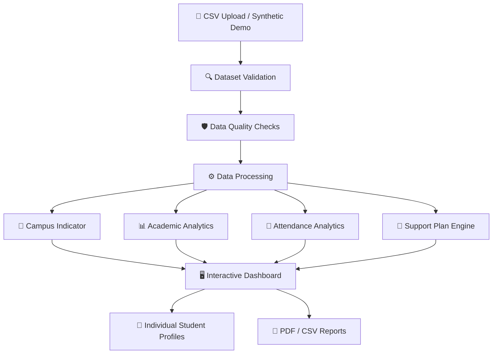

# 🎓 CampusPulse AI
### NEXT-GENERATION SMART CAMPUS INTELLIGENCE SYSTEM

<p align="center">
  
  
  
  
  
</p>

<p align="center">
  <strong>Explore Data. Discover Patterns. Enable Smarter Campus Insights.</strong>
</p>

<p align="center">
  A privacy-aware educational analytics platform that transforms student datasets into interactive academic insights, attendance intelligence, and explainable student-support indicators.
</p>

---

## 🌌 SYSTEM OVERVIEW

**CampusPulse AI** is a Smart Campus Intelligence System developed to make educational data easier to explore, understand, and interpret.

It brings together academic analytics, attendance monitoring, data-quality diagnostics, transparent weighted scoring, rule-based student-support screening, and individual student reporting in one interactive dashboard.

Designed with a futuristic dark interface, animated visual elements, interactive charts, and modular Python architecture, CampusPulse AI provides an engaging environment for campus-level data exploration.

### ✦ The Mission

To transform disconnected student records into structured, explainable information that can support more informed human review and campus-level understanding.

### ◈ The Core Concept

**DATA → VALIDATION → ANALYSIS → INTELLIGENCE → INSIGHTS → REPORTS**

---

## 🧬 WHAT MAKES CAMPUSPULSE AI DIFFERENT?

| Capability | Description |
|---|---|
| ⚡ Interactive Experience | Eight integrated dashboard modules |
| 🧠 Explainable Analytics | Transparent weighted Campus Indicator |
| 📊 Academic Intelligence | Marks analysis and department comparisons |
| 📅 Attendance Intelligence | Attendance distribution and threshold-based review |
| 🛡️ Data Quality Centre | Missing values, validation notices, and completeness |
| 🤝 Student Support | Rule-based support screening |
| 👤 Individual Profiles | Student-level analytical information |
| 📑 Smart Reporting | PDF and CSV exports |
| 🎨 Futuristic Interface | Dark navy theme, cyan-purple gradients, hover effects, and animated elements |
| 🧪 Modular Engineering | Separated Python modules and automated tests |

---

# 🚀 01. THE CAMPUSPULSE EXPERIENCE

## 🖥️ Eight Integrated Intelligence Modules

### 01 — 🏠 Campus Overview

The central command centre of CampusPulse AI.

- Total student-record count.
- Average academic marks.
- Average attendance.
- Average Campus Indicator.
- Support-flag count.
- Marks and attendance distributions.
- Department-level academic comparisons.
- Campus Indicator visualization.

### 02 — 📚 Academic Intelligence

Explore academic performance through descriptive analytics.

- Average, median, highest, and lowest marks.
- Academic performance distribution.
- Reference pass-rate visualization.
- Student-level marks table.
- Department and year filtering.

### 03 — 📅 Attendance Intelligence

Understand attendance patterns and identify records for further review.

- Average attendance.
- Records below the 75% reference threshold.
- Attendance distribution.
- Low-attendance record exploration.
- Integration with Student Support status.

### 04 — 🧠 Data Insights Engine

Explore relationships and unusual observations in numerical data.

- Correlation matrix.
- Correlation heatmap.
- IQR-based outlier exploration.
- Average indicator component breakdown.

**Important:** Correlation does not establish causation. Statistical outliers are not automatically errors.

### 05 — 🛡️ Data Quality Centre

Understand the condition of the uploaded dataset.

- Row and column counts.
- Dataset completeness percentage.
- Column-level quality report.
- Missing-value analysis.
- Validation notices.
- Missing-value visualizations.

### 06 — 🤝 Student Support Intelligence

A rule-based screening environment designed to highlight records that may deserve further human review.

Support categories include:

- High support priority.
- Needs academic support.
- Needs attendance support.
- Partial data.
- Insufficient data.
- On track.

The module also displays support reasons and recommended actions when supplied by the support-plan logic.

### 07 — 👤 Individual Student Profile

Explore a selected student's available analytical information.

- Student name and department.
- Academic year.
- Marks and attendance.
- Campus Indicator.
- Indicator coverage and band.
- Support status and reason.
- Recommended action.
- Indicator component breakdown.
- Individual PDF report download.

### 08 — 📄 Reports & Exports

Generate downloadable analytical outputs.

- Analysed campus CSV.
- Data-quality CSV.
- Campus PDF report.
- Individual student PDF report.
- Current filtered report summary.

---

# 🔄 02. HOW THE SYSTEM WORKS

CampusPulse AI follows a structured data-processing pipeline.



## ⚙️ Execution Pipeline — Step by Step

**STEP 01 — DATA ACQUISITION**

Users upload a CSV file through the Streamlit sidebar or load synthetic demonstration data.

The upload interface enforces a configured maximum file size and accepts CSV files.

**STEP 02 — DATA VALIDATION**

The dataset is passed through the existing data-loading module.

- Schema validation.
- Numeric-value handling.
- Missing-value identification.
- Configured range checks.
- Validation notices.

**STEP 03 — INDICATOR CALCULATION**

The validated dataset is passed into the scoring engine, which calculates the Campus Indicator using available components.

**STEP 04 — SUPPORT SCREENING**

The intervention module creates a support plan using predefined rules.

**STEP 05 — FILTERING**

Users can explore records through:

- Department filters.
- Academic-year filters.
- Marks-range filtering.

The selected records are reprocessed for indicator and support analysis.

**STEP 06 — ANALYTICS GENERATION**

The dashboard calculates academic summaries, attendance summaries, department comparisons, correlation information, and outlier summaries.

**STEP 07 — VISUAL EXPLORATION**

Results are presented through Streamlit metrics, Plotly charts, data tables, and the eight dashboard tabs.

**STEP 08 — REPORT GENERATION**

Users can download campus-level and individual PDF/CSV reports.

---

# 🧮 03. EXPLAINABLE CAMPUS INDICATOR

The Campus Indicator is a transparent weighted scoring mechanism designed to summarize selected available inputs.

## Default Component Weights

| Component | Weight |
|---|---:|
| Academic Marks | 40% |
| Attendance | 25% |
| Study Hours | 15% |
| Sleep Target Score | 10% |
| Screen-Time Target Score | 10% |
| **Total** | **100%** |

### How the scoring works

1. Each available component is transformed into a score.
2. Configured weights are renormalised over the available components for each record.
3. The final indicator is calculated using the available weighted components.
4. `Indicator_Coverage` reports the percentage of configured weight represented by available inputs.

### Why indicator coverage matters

Not every uploaded record contains every optional input.

Indicator coverage helps communicate how much of the configured scoring information was available when calculating an individual's indicator.

**Implementation:** `src/campuspulse/scoring.py`

> Sleep and screen-time targets are illustrative design assumptions, not health guidance. The Campus Indicator is a heuristic and is not a validated measure of student potential.

---

# 🎨 04. FUTURISTIC USER INTERFACE

CampusPulse AI features a custom-designed Streamlit interface.

### Visual identity

| UI Element | Design |
|---|---|
| Background | Deep navy and midnight blue |
| Primary accent | Electric cyan |
| Secondary accent | Indigo and violet |
| Typography | Inter |
| Hero section | Gradient panel with animated glow |
| Branding | Floating gradient logo |
| KPI cards | Hover elevation and 3D-style transforms |
| Buttons | Cyan-blue gradient interactions |
| Dashboard tabs | Dark rounded navigation |
| Analytics | Dark-themed Plotly visualizations |

### Interface experience

- Animated hero entrance.
- Floating logo animation.
- Gradient lighting effects.
- Hover-responsive KPI cards.
- Interactive dashboard navigation.
- Responsive layout adjustments.
- Optional interface sound-effect test.
- Reduced-motion CSS support.

The visual design uses custom CSS alongside Streamlit components and embedded browser-side audio interaction.

---

# 🏗️ 05. SYSTEM ARCHITECTURE

CampusPulse AI separates dashboard presentation from core data and analytics operations.

```text
                 CAMPUSPULSE AI
                       |
              STREAMLIT FRONTEND
                    app.py
                       |
        +--------------+--------------+
        |              |              |
     DATA LAYER    ANALYTICS       UI / CHARTS
        |           ENGINE             |
     data.py      analytics.py      charts.py
        |           |
        |         scoring.py
        |           |
        |      interventions.py
        |           |
        +-----------+-----------------+
                    |
              REPORTING ENGINE
                    |
             +------+------+
             |             |
         reporting.py  pdf_reporting.py
             |             |
          CSV DATA      PDF REPORTS
```

## 📁 Project Directory

```text
CampusPulse_AI_Hackathon/
│
├── app.py
├── main.py
├── requirements.txt
├── pyproject.toml
├── README.md
│
├── .streamlit/
│   └── config.toml
│
├── data/
│
├── src/
│   └── campuspulse/
│       ├── analytics.py
│       ├── charts.py
│       ├── config.py
│       ├── data.py
│       ├── scoring.py
│       ├── reporting.py
│       ├── interventions.py
│       └── pdf_reporting.py
│
└── tests/
    ├── test_analytics.py
    ├── test_data.py
    ├── test_scoring.py
    └── test_interventions.py
```

---

# 🛠️ 06. TECHNOLOGY STACK

| Technology | Application |
|---|---|
| Python | Core programming language |
| Streamlit | Interactive dashboard framework |
| Pandas | Data processing and manipulation |
| NumPy | Numerical computation and synthetic data generation |
| Plotly Express | Interactive charts and visualizations |
| Seaborn | Statistical visualization support |
| Matplotlib | Heatmap and visualization support |
| ReportLab | PDF report generation |
| Pytest | Automated testing |

### Key Python integrations

- `streamlit` — dashboard and user interaction.
- `pandas` — tabular data processing.
- `numpy` — numerical operations.
- `plotly.express` — interactive visualizations.
- `logging` — application error logging.
- `datetime` — report timestamps.
- `io` — in-memory CSV processing.

---

# 💻 07. INSTALLATION & EXECUTION

## System Requirements

- Python installed.
- VS Code or another Python editor.
- PowerShell on Windows or a terminal on macOS/Linux.
- Git (optional).

## Step 1 — Clone the repository

```bash
git clone YOUR_GITHUB_REPOSITORY_URL
cd CampusPulse_AI_Hackathon
```

Replace the URL with your actual GitHub repository address.

## Step 2 — Create a virtual environment

**Windows PowerShell**

```powershell
py -m venv venv
```

If `py` is not recognized:

```powershell
python -m venv venv
```

## Step 3 — Activate the environment

```powershell
.\venv\Scripts\Activate.ps1
```

**macOS / Linux**

```bash
python3 -m venv venv
source venv/bin/activate
```

## Step 4 — Install dependencies

```bash
python -m pip install --upgrade pip
pip install -r requirements.txt
```

## Step 5 — Launch CampusPulse AI

```bash
python -m streamlit run app.py
```

Open the local URL shown in the terminal.

## Step 6 — Run automated tests

```bash
python -m pytest -v
```

## Step 7 — Run CLI demonstration

```bash
python main.py
```

---

# 📊 08. DATASET SPECIFICATION

CampusPulse AI accepts CSV datasets.

## Required columns

| Column | Description |
|---|---|
| `Name` | Student name or pseudonymous name |
| `Marks` | Academic marks |

## Optional columns

| Column | Description |
|---|---|
| `Attendance` | Attendance percentage |
| `Study_Hours` | Study duration |
| `Sleep_Hours` | Sleep duration |
| `Screen_Time` | Screen-time duration |
| `Department` | Department |
| `Year` | Academic year |
| `Student_ID` | Student identifier |

## Validation ranges

| Field | Range |
|---|---|
| Marks | 0–100 |
| Attendance | 0–100 |
| Hour-based fields | 0–24 |

### Dataset behaviour

- Invalid numeric cells are converted into missing values and reported.
- Out-of-range values are converted into missing values and reported.
- Missing values and duplicate information are included in quality analysis.
- Additional columns are retained.

### Synthetic demonstration dataset

The application can generate a reproducible demonstration dataset containing 80 pseudonymous student records.

It includes:

- Five departments: CSE, ECE, IT, ME, CE.
- Academic years 1–4.
- Synthetic marks.
- Synthetic attendance.
- Study hours.
- Sleep hours.
- Screen time.

The demonstration data is generated using NumPy's seeded random generator.

---

# 🧪 09. TESTING & QUALITY ASSURANCE

The project includes a modular automated testing structure using pytest.

| Test Module | Testing Area |
|---|---|
| `test_analytics.py` | Analytics functionality |
| `test_data.py` | Dataset handling |
| `test_scoring.py` | Campus Indicator calculations |
| `test_interventions.py` | Student Support logic |

Run all tests:

```bash
python -m pytest -v
```

---

# 🔐 10. PRIVACY & RESPONSIBLE ANALYTICS

CampusPulse AI is designed as a privacy-aware educational prototype.

### Recommended data practices

- Use synthetic, anonymised, or properly consented data.
- Avoid uploading identifiable student information to public deployments.
- Restrict access to sensitive datasets.
- Follow institutional data-protection requirements.

### Before production deployment

Additional safeguards would be necessary:

- Institutional authentication.
- Role-based access control.
- Encrypted storage.
- Audit logs.
- Data-retention controls.
- Independent security reviews.

### ⚠️ Important limitations and disclaimer

CampusPulse AI is an educational analytics prototype.

It is not a validated AI prediction system, medical tool, diagnostic system, or measure of student potential.

- The Campus Indicator is heuristic and descriptive.
- Student Support uses predefined rules, not trained machine learning.
- A flagged record does not establish that a student is facing a problem.
- Correlation does not prove causation.
- Outlier detection identifies unusual observations, not necessarily errors.
- Sleep and screen-time targets are illustrative assumptions.
- Results depend on dataset quality and completeness.

**Human judgement and contextual review must remain central to any student-related interpretation or decision.**

---

# 🔮 11. FUTURE DEVELOPMENT

| Enhancement | Objective |
|---|---|
| 👥 Role-Based Access | Separate permissions for students, faculty, and administrators |
| ⚙️ Configurable Scoring | Allow transparent customization of component weights |
| 🔍 Advanced Data Diagnostics | Expand validation and quality reporting |
| 📊 Enhanced Explainability | Improve visibility into analytical transformations |
| ♿ Accessibility Improvements | Support more inclusive dashboard interaction |
| 🔐 Security Enhancements | Strengthen safeguards for sensitive datasets |
| 🏫 Institutional Evaluation | Validate suitability before real-world deployment |

---

# 🎬 12. HACKATHON DEMONSTRATION FLOW

A suggested presentation sequence:

| Step | Demonstration |
|---:|---|
| 01 | Launch the futuristic CampusPulse dashboard |
| 02 | Introduce the project vision |
| 03 | Upload a CSV dataset |
| 04 | Demonstrate validation and data-quality analysis |
| 05 | Explore academic performance |
| 06 | Explore attendance patterns |
| 07 | Demonstrate correlation and outlier insights |
| 08 | Explain Campus Indicator weights and coverage |
| 09 | Demonstrate Student Support screening |
| 10 | Open an individual student profile |
| 11 | Generate campus and individual PDF reports |
| 12 | Explain privacy and responsible-use limitations |

---

# 🏁 13. PROJECT STATUS

**CampusPulse AI — Smart Campus Intelligence System**

An educational hackathon prototype bringing together:

- Interactive Streamlit dashboard.
- Academic and attendance analytics.
- Explainable weighted Campus Indicator.
- Rule-based Student Support screening.
- Data quality diagnostics.
- Department comparisons.
- Individual student profiles.
- PDF and CSV reporting.
- Modular Python architecture.
- Automated pytest test suite.

### The Vision

> Making campus data easier to understand, analytics more transparent, and student support more informed.

---

<p align="center">
  
</p>

<p align="center">
  <strong>🎓 CAMPUSPULSE AI</strong>
  <br/>
  <em>Explore Data. Discover Patterns. Support Smarter Campuses.</em>
  <br/><br/>
  <sub>Smart Campus Intelligence • Explainable Analytics • Responsible Technology</sub>
</p>